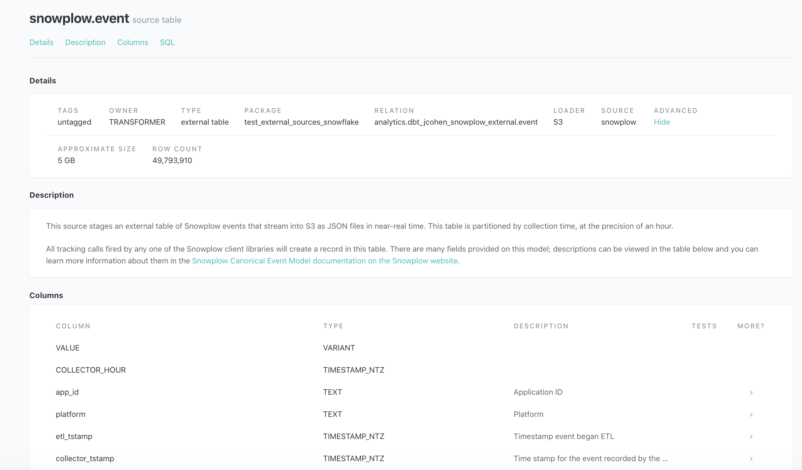

# External sources in dbt

dbt v0.15.0 [added support](https://github.com/dbt-labs/dbt/pull/1784) for an `external` property within `sources` that can include information about `location`, `partitions`, and other database-specific properties.

This package provides:
* Macros to create/replace external tables and refresh their partitions, using the metadata provided in your `.yml` file source definitions
* Snowflake-specific macros to create, backfill, and refresh snowpipes, using the same metadata

## Adapter implementations

* Redshift (Spectrum)
* Snowflake (external tables and Snowpipe)
* BigQuery
* Spark
* Fabric

Your dbt v2 build must include the adapter for your target. See [dbt v2 supported data platforms](https://docs.getdbt.com/docs/supported-data-platforms?version=2) for availability.



## Installation

Follow the instructions at [hub.getdbt.com](https://hub.getdbt.com/dbt-labs/dbt_external_tables/latest/) on how to modify your `packages.yml` and run `dbt deps`.

This version requires a dbt v2 (Fusion) build with `run-operation --per-node`. BigQuery also requires support for a per-node operation plan with a post-SQL macro. Check for `--per-node` with `dbt run-operation --help`. The [integration test guide](integration_tests) explains how to test with a compatible build.

## Syntax

Run `dbt_external_tables.stage` once for each source table you select. A standard run creates missing external tables and refreshes existing tables according to the adapter and source configuration. Set `ext_full_refresh: true` to replace the selected tables.

```bash
# Create missing external tables and refresh existing ones
dbt run-operation dbt_external_tables.stage --per-node --select 'source:*'

# Recreate the selected external tables
dbt run-operation dbt_external_tables.stage --per-node --select 'source:*' --vars 'ext_full_refresh: true'
```

Use `--threads` to set the concurrency limit. Select each physical table or pipe once so the operations can run independently. dbt skips selected nodes without an `external` source definition and records a result per selected node in `target/run_results.json`.

### Migrating existing staging jobs

Replace calls to `stage_external_sources` with `dbt_external_tables.stage --per-node`. Translate the former `--args` selection into dbt's [source selectors](https://docs.getdbt.com/reference/node-selection/methods#source).

```bash
# Stage all external tables in the snowplow and logs sources
dbt run-operation dbt_external_tables.stage --per-node --select source:snowplow source:logs --threads 8

# Stage one external source table
dbt run-operation dbt_external_tables.stage --per-node --select source:snowplow.event
```

If you called the old macro from `on-run-start` or another hook, move staging to a separate job step before the command that consumes the sources.

For project overrides, `ADAPTER__stage(node)` remains the per-node entry point. Build-plan and SQL-generating overrides take `source_node` and use `this` for the exact selected relation. Return the SQL in execution order. BigQuery uses a structured plan with `sql` and `post_macro` keys to update column metadata after DDL, including when the SQL list is empty. To migrate a custom column metadata override, return its qualified macro name in `post_macro`. The macro accepts `node` and uses `this` to address the selected relation.

## Setup

Before staging, create the target database and schema or project and dataset. Set up the platform's required external resources and grant dbt permission to create and refresh tables in the target.

Prepare the external resources for your target.

- An external stage for Snowflake
- An external schema and S3 bucket for Redshift Spectrum
- An external data source and file format for Fabric
- A Google Cloud Storage bucket for BigQuery
- An accessible set of files for Spark

## Spec

```yml
version: 2

sources:
  - name: snowplow
    tables:
      - name: event
        description: >
            This source table is actually a set of files in external storage.
            The dbt-external-tables package provides handy macros for getting
            those files queryable, just in time for modeling.
                            
        external:
          location:         # required: S3 or GCS file path, Snowflake stage, or file path for a Fabric external data source
          
          ...               # database-specific properties of external table
          
          partitions:       # optional
            - name: collector_date
              data_type: date
              ...           # database-specific properties

        # Specify ALL column names + datatypes.
        # Column order must match for CSVs, column names must match for other formats.
        # Some databases support schema inference.

        columns:
          - name: app_id
            data_type: varchar(255)
            description: "Application ID"
          - name: platform
            data_type: varchar(255)
            description: "Platform"
          ...

        # Use `meta` to pass custom column properties (e.g. alias, expression)
        columns:
          - name: raw_timestamp
            data_type: timestamp
            config:
              meta:
                alias: event_timestamp       # rename the column in the external table
                expression: TO_TIMESTAMP(...) # custom SQL expression instead of default value extraction
```

The per-node macro uses this configuration to build the SQL for each external table. dbt executes the statements in order for each source.

## Resources

* [`sample_sources`](sample_sources): detailed example source specs, with annotations, for each database's implementation
* [`integration test fixtures`](integration_tests/models/plugins): source spec variations used by the integration tests

If you encounter issues using this package or have questions, please check the [open issues](https://github.com/dbt-labs/dbt-external-tables/issues), as there's a chance it's a known limitation or work in progress. If not, you can:
- open a new issue to report a bug or suggest an enhancement
- post a technical question to [the Community Forum](https://discourse.getdbt.com/c/help/19)
- post a conceptual question to the relevant database channel (#db-redshift, #dbt-snowflake, etc) in the [dbt Slack community](https://community.getdbt.com/)

Additional contributions to this package are very welcome! Please create issues or open PRs against `main`. Check out [this post](https://discourse.getdbt.com/t/contributing-to-an-external-dbt-package/657) on the best workflow for contributing to a package.
